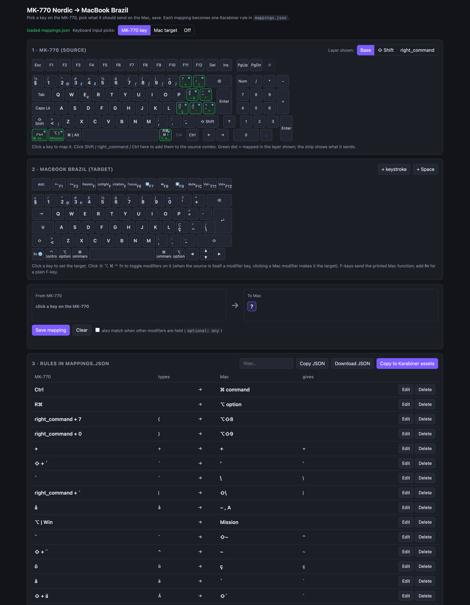

# Key Mapper

Small local web UI for building [Karabiner-Elements](https://karabiner-elements.pqrs.org/) rules that make a Cooler Master **MK-770 (Nordic ISO)** keyboard type correctly on a **MacBook** using the macOS **Portuguese** input source.

Pick a key (and modifiers) on the MK-770, pick what it should send on the Mac, save. Each mapping becomes a Karabiner `complex_modifications` rule.



## Run

```sh
node server.js
```

Open http://localhost:4777. No dependencies. Set `PORT` to change the port.

## Files

| File | Purpose |
|---|---|
| `server.js` | Local server: serves the UI, reads/writes the JSON files, copies rules into Karabiner. |
| `index.html` | The mapper UI (MK-770 and Mac layouts, rule composer, rule list). |
| `mappings.json` | Source of truth. Karabiner asset format: `{ "title", "rules": [...] }`. |
| `mapper.config.json` | UI settings: device IDs, the source key code used for the AltGr layer, per-key code overrides. |

## Getting rules into Karabiner

There are two ways, and they take different JSON shapes.

**Add your own rule** (one toggle for everything)

1. Click **Copy JSON** (or **Download JSON**). Both give a single rule: `{ "description", "manipulators": [...] }` with every mapping merged in table order.
2. Karabiner → Complex Modifications → **Add your own rule** → paste → save.
3. After changing mappings, replace that rule with a fresh copy.

Pasting `mappings.json` itself here fails with `` `manipulators` is missing or empty ``, because that file is the asset format, not a single rule.

**Add predefined rule** (one toggle per mapping)

1. Click **Copy to Karabiner assets**. This writes `mappings.json` to `~/.config/karabiner/assets/complex_modifications/mk770-nordic-to-mac.json`.
2. Karabiner → Complex Modifications → **Add predefined rule** → enable the rules you want.
3. Enabled rules are copies: after editing a mapping, remove the old rule and add it again.

Either way, delete old MK-770 rules before adding new ones. Karabiner uses the first manipulator that matches, so a stale duplicate silently wins.

## Things worth knowing

- **The MK-770 is in Mac mode.** It swaps Win/Alt and sends `right_command` for AltGr. The UI layout uses those real codes: Win = `left_option`, Alt = `left_command`, AltGr = `right_command` (shown as `R⌘`). Check any key in **Karabiner-EventViewer** if a rule never fires; fix wrong codes with the per-key override field.
- **Combos match the modifier after remapping.** The `R⌘ → ⌥ option` rule turns `right_command` into `right_option` before other rules see it, so AltGr-layer combos must use `mandatory: ["right_option"]`. That is why `mapper.config.json` has `"right_command": "right_option"`.
- **Device filter.** Rules carry a `device_if` condition with the MK-770 vendor/product IDs (wired and 2.4 GHz dongle), so the MacBook's own keyboard is untouched.
- **Mac input source.** The Mac layout in the UI matches macOS **Portuguese**, not Brazilian. Switching input source moves keys and breaks the rules.
- **Rule titles** read `MK: <keys> (<character typed>) → MAC: <keys>`. The UI regenerates them from the rule contents on load.
